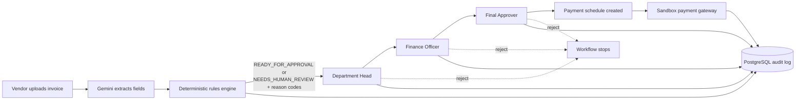

<div align="center">

# 🧾 Autonomous Accounts Payable & Vendor Invoice Agent

**AI prepares the evidence. Deterministic Python enforces the rules. Humans make the decision.**

*JKLU AI Buildathon 2026 · Problem Statement 09*

-3776AB?logo=python&logoColor=white)


</div>

---

## The problem

Accounts payable teams check every vendor invoice by hand against the purchase order (PO), the goods receipt (GRN), the vendor master and the department budget. It is slow, error-prone and leaves little record of *why* an invoice was paid. Duplicate invoices, price hikes, short deliveries and over-budget spending slip through.

The obvious instinct is to point an LLM at the invoice and let it decide. That is risky: a model can be prompt-injected, can hallucinate a PO number, and leaves no reproducible audit trail.

## Our approach

We split the work into four layers of trust:

| Layer | Who does it | Trust level |
|---|---|---|
| **1. Read and investigate** | Gemini reads the PDF/image, plans which checks to run and calls them as tools, revising its plan when a result calls for it. Output is schema-validated. | Untrusted |
| **2. Check** | `rules.py` runs deterministic checks (arithmetic, vendor, GSTIN, PO, GRN, budget, GST, FX, duplicates) and returns reason codes. No LLM involved. | Trusted, reproducible |
| **3. Approve** | Three people sign off in sequence: Department Head → Finance Officer → Final Approver. | Trusted, accountable |
| **4. Pay** | After final approval, a payment schedule is created and the Final Approver pays through a sandbox payment gateway. | Trusted, auditable |

A hallucination stops at Layer 1: the rules engine never trusts it, and no payment can happen without three human approvals.



---

## Features

### 🤖 AI invoice reading
- Upload PDF, JPG, PNG or WEBP invoices.
- Gemini extracts the vendor, invoice number, PO reference, line items, taxes and totals, with retries and fallback models.
- Field-name normalisation handles real-world variation (`invoice_no`, `invoice_number`, `invoice_id`, …).
- Content-hash duplicate detection blocks the same document being submitted twice.

### 🧭 Agent planning and recovery (`agent.py`, `agent_tools.py`)
- Gemini is given a goal, not a script. It records its investigation plan first (`record_plan`), then calls the check tools one at a time and decides what to do next from each result.
- When a result changes what needs checking, the agent records a revised plan with the reason. Both plans are saved to the audit log (`agent:plan`, `agent:plan_revised`).
- If the invoice has no PO, or its PO is not found, the agent calls `find_candidate_pos` to search purchase orders from the same vendor and rank them by amount and items. These are suggestions for a human to confirm; a candidate is never used as the invoice's PO.
- A Python safety guard re-runs any required check the model skipped, so the evidence is complete whatever the model does.
- Every summary ends with a **Verified findings** block built in Python from the rules engine, so approvers never rely on the model's own retelling of the reason codes.

### ✅ Deterministic validation (`rules.py`)
Every check returns a machine-readable reason code:

| Check | Reason codes |
|---|---|
| Arithmetic | `INVOICE_ARITHMETIC_MISMATCH` |
| Vendor identity | `VENDOR_GSTIN_MISMATCH` |
| PO mapping | `MISSING_PO_REFERENCE`, `PO_REFERENCE_UNMAPPED`, `CANCELLED_PO` |
| Pricing | `PO_UNIT_PRICE_MISMATCH`, `PRICE_VARIANCE_WITHIN_TOLERANCE` (informational) |
| Goods receipt | `MISSING_GOODS_RECEIPT`, `GRN_QUANTITY_SHORTAGE` |
| Over-billing | `DUPLICATE_INVOICE`, `CUMULATIVE_PO_OVERBILL` |
| Tax and currency | `GST_RATE_MISMATCH`, `FX_RATE_MISMATCH` |
| Budget | `BUDGET_EXCEEDED` |
| Special cases | `CREDIT_NOTE_SPECIAL_HANDLING`, `LOW_DOCUMENT_QUALITY`, `INCOMPLETE_EXTRACTION` |

The final recommendation is always one of `READY_FOR_APPROVAL` or `NEEDS_HUMAN_REVIEW`. It is advisory: it never approves anything by itself.

### 👥 Three-stage human approval
- Sequential Department Head → Finance Officer → Final Approver workflow with row-level locking.
- Each stage records the reviewer, timestamp, decision and note.
- A two-step confirmation dialog for every decision.
- A rejection at any stage ends the workflow immediately.

### 💳 Payment gateway (sandbox)
- When the Final Approver approves the last stage, a payment schedule is created and a **payment window opens automatically**.
- Pay by UPI, debit/credit card or net banking.
- Safeguards:
  - Only the Final Approver who approved the invoice (or a Finance Officer/Admin) can pay it.
  - The charged amount must match the scheduled amount.
  - An invoice cannot be paid twice.
- Only the last 4 card digits are stored. The full card number and CVV are never saved or logged.
- Sandbox only: no bank is contacted and no money moves. A failed payment leaves the invoice scheduled and can be retried from the **Payment schedule** tab.

### 📨 Vendor clarification loop
When an invoice is flagged, the vendor sees a specific "action needed" message in **My submissions** and can acknowledge it before re-uploading.

### 🧾 Procurement records
Procurement Officers can create purchase orders, mapped to a department for budget checks, and record goods receipts, service confirmations and returns.

**Upload instead of typing.** A procurement officer can upload a purchase order or a goods receipt / delivery note as an image, PDF, Word (.docx), Excel (.xlsx) or JSON file. Images and PDFs go to Gemini as files; Word, Excel and JSON are converted to text first (standard library only, no extra packages) and read with the same prompt. Gemini fills the existing form; the officer reviews it and still has to generate the preview and save. Python checks the reading first: the vendor, department and currency are only filled when they match the reference lists, a receipt is only attached to a purchase order that is open for receipt, quantities are capped at what is still outstanding, and the line amounts are re-added against the printed subtotal. Anything that does not match is shown as a warning, not guessed. Sample documents are in `demo_test_documents/`.

### 🖥️ Interface
- A calm, minimal theme (`theme.py`, `.streamlit/config.toml`): graphite sidebar, one teal accent, the Instrument Sans typeface and tabular figures for amounts.
- The sidebar shows who is signed in and their role, with each workspace as a menu item.
- Amount tiles in the finance workspace and approvals shrink long figures to fit. If a figure still has to be shortened with "…", hovering over the tile (or tabbing to it) shows the full amount.
- The sign-in page says exactly what went wrong (missing field, wrong password, account paused) and how many attempts are left.

### 💰 Department budgets (`budget_store.py`)
- **Create purchase order** shows the chosen department's allocated, already-used and available budget as soon as the department is picked.
- The PO preview shows what the order leaves in the budget and warns clearly if it goes over. Foreign-currency POs are converted to INR with the reference exchange rate first. An over-budget PO can still be saved, so a person decides. The check result is stored on the PO (`budget_check_at_creation`) and in the audit log.
- Finance Officers and Admins can change a department's allocated budget in the **Finance workspace**. A reason is required, the budget cannot go below what is already used, and every change is kept in a history table and the audit log (`finance:budget_change`). Procurement cannot change budgets.
- Changes are stored in `data/department_budgets.json`, never in the dataset, and the agent's invoice budget check reads the same live figures. `reset_and_start_demo.bat` clears them.

### 🔍 Audit trail
Every AI step, rule result, upload, login, decision and payment is written to PostgreSQL. Admins can search and filter the log and export it to CSV.

---

## Roles

| Role | What they can do |
|---|---|
| **Vendor** | Upload invoices, view submission status and clarification requests |
| **Procurement Officer** | Create and track purchase orders and goods receipts |
| **Department Head** | Approve or reject stage 1 |
| **Finance Officer** | Approve or reject stage 2; process or cancel scheduled payments; change department budgets in the finance workspace |
| **Final Approver** | Approve or reject stage 3; pay approved invoices through the gateway |
| **Admin** | Approvals, finance workspace (change budgets, payments) and the audit log |

Passwords are hashed with PBKDF2-SHA256 (200,000 iterations).

---

## Tech stack

| Area | Technology |
|---|---|
| Language | Python 3.10+ (built and tested on 3.14) |
| UI | Streamlit 1.66, custom theme |
| Database | PostgreSQL 17 (`psycopg2-binary`) |
| AI | Google Gemini (`google-genai` 2.34) with automatic function calling |
| Agent | Built directly on Gemini function calling (no LangChain or other agent framework), so our own code controls the safety checks |
| Configuration | `python-dotenv` |
| Office and JSON uploads | Python standard library (`zipfile`, `xml.etree`, `json`) |
| Testing | pytest |

Exact versions are pinned in [`requirements.txt`](requirements.txt).

---

## Getting started (Windows)

### Prerequisites
- Python 3.10 or later on your PATH (the project was built and tested on Python 3.14)
- A [Google Gemini API key](https://aistudio.google.com/apikey)
- Windows 10/11, for the one-click scripts. On other systems, follow the manual steps below.

### 1. Install and start the app
Double-click **`run_app.bat`**, or run it from PowerShell:

```powershell
.\run_app.bat
```

The first run:
1. creates a `.venv` virtual environment;
2. installs `requirements.txt`;
3. runs a preflight check;
4. starts the app at **http://localhost:8501**.

### 2. Set up the database (one time)
Double-click **`setup_database.bat`**. It:
1. installs **PostgreSQL 17** if it isn't installed. It downloads the official installer, verifies its SHA-256 against the winget manifest, and asks for administrator permission once;
2. writes the database settings to `.env`, with a randomly generated local password;
3. creates all tables and loads the demo data and accounts;
4. runs the preflight check.

It is safe to run again: existing settings and data are kept. The full output is saved to `setup.log`.

### 3. Add your Gemini key
Open `.env` (created by the database setup, or copy `.env.example` to `.env`) and paste your key:

```env
GEMINI_API_KEY=your_key_here
```

Then restart the app.

### Configuration reference (`.env`)

| Variable | Purpose | Default |
|---|---|---|
| `GEMINI_API_KEY` | Gemini API key (required for AI reading) | none |
| `MODEL` | Primary Gemini model | `gemini-3.5-flash-lite` for the agent, `gemini-3.1-flash-lite` for document reading |
| `FALLBACK_MODELS` | Comma-separated backup models (`FALLBACK_MODEL` also works) | none |
| `MAX_ATTEMPTS` | Retries per model | `2` |
| `DB_NAME` / `DB_USER` / `DB_PASSWORD` | PostgreSQL database and credentials | `invoice_db` / `postgres` / none |
| `DB_HOST` / `DB_PORT` | PostgreSQL server | `localhost` / `5432` |

> `.env` is listed in `.gitignore`. Never commit it.

### Manual setup (any OS)

```bash
python -m venv .venv
# Windows: .venv\Scripts\activate    macOS/Linux: source .venv/bin/activate
pip install -r requirements.txt

# copy .env.example to .env and fill it in; with PostgreSQL running, then:
python db_setup.py            # creates the database and core tables
python setup_agent_tables.py  # agent, approval and payment tables
python seed_users.py          # demo accounts
python seed_db.py             # demo vendors, POs and GRNs
python check_setup.py         # preflight check

python -m streamlit run app.py
```

---

## Running the demo

Reset to a clean state and start the app:

```powershell
.\reset_and_start_demo.bat
```

This stops any running copy, clears approvals, payments, the activity log, uploaded copies and budget changes, then starts the app. Demo accounts and seed data are kept.

### Demo accounts

| Role | Username |
|---|---|
| Vendor | `vendor1` |
| Procurement Officer | `procurement1` |
| Department Head | `depthead1` |
| Finance Officer | `finance1` |
| Final Approver | `approver1` |
| Admin | `admin1` |

Passwords are in [`seed_users.py`](seed_users.py). They are demo-only; change them before any real use.

### Suggested walkthrough
1. **Vendor:** upload `demo_test_invoices/clean_match_130.pdf` and review the AI verification report.
2. **Vendor:** upload a discrepancy invoice, e.g. `price_mismatch_132.pdf` or `missing_po_9999.pdf`, and see the reason codes. For the missing PO, the agent revises its plan and suggests likely purchase orders for a human to confirm.
3. **Vendor:** upload `clean_match_130.pdf` again; the duplicate is blocked.
4. **Department Head → Finance Officer → Final Approver:** approve the clean invoice at each stage.
5. **Final Approver:** the payment window opens. Pay with sandbox card `4111 1111 1111 1111` (any future expiry, any CVV). Press Enter after the CVV, then click Pay.
6. **Admin:** open the audit log and search for `payment` to see the full trail.
7. **Procurement Officer:** on **Purchase Orders → Create purchase order**, upload `demo_test_documents/sample_purchase_order_PO-142.xlsx`. The form fills itself; check it, generate the preview and save. On **Goods Receipts → Record goods receipt**, upload `sample_goods_receipt_PO-135.json` the same way.

`reset_and_start_demo.bat` removes the records these sample documents create (PO-140 to PO-143 and the PO-135 goods receipt), so the walkthrough can be repeated.

### Demo scenarios

The `demo_test_invoices/` folder contains these test invoices:

| File | Expected result |
|---|---|
| `clean_match_130.pdf` | Passes all checks → ready for approval |
| `quantity_mismatch_131.pdf` | Quantity exceeds the PO/GRN |
| `price_mismatch_132.pdf` | Unit price differs from the PO |
| `wrong_vendor.pdf` | Vendor differs from the PO |
| `wrong_gst_134.pdf` | GST rate differs from the PO |
| `missing_grn_135.pdf` | No goods receipt |
| `partial_receipt_136.pdf` | Only part of the order was received |
| `budget_exceeded-137.pdf` | Department budget insufficient |
| `missing_po_9999.pdf` | PO not found → agent suggests candidate POs for a human to confirm |

### Sandbox payment test credentials

| Method | Succeeds | Declined |
|---|---|---|
| Card | `4111 1111 1111 1111` | `4000 0000 0000 0002` |
| UPI | `success@sandbox` | `failure@sandbox` |
| Net banking | any listed bank | `Sandbox Bank (decline)` |

---

## Testing

```bash
python rules.py          # 20 deterministic rule cases from the synthetic dataset
python -m pytest -q      # about 200 unit and integration tests
```

Main test files:

| File | What it covers |
|---|---|
| `test_matcher.py`, `test_budget_checker.py`, `test_budget_evidence.py` | Three-way matching and budget checks |
| `test_budget_store.py` | Live budgets, the PO budget check, currency conversion and who may change a budget |
| `test_agent_required_checks.py`, `test_agent_retry.py`, `test_agent_failure.py` | The agent's safety guard, retries and fail-safe to human review |
| `test_approval_workflow.py` | Three-stage approval order and rejection |
| `test_payment_gateway.py` | Sandbox payments, amount checks and double-payment protection |
| `test_auth_login.py` | Sign-in results, lockout after repeated failures, input limits |
| `test_extract_invoice.py`, `test_extract_procurement.py` | Invoice reading, and PO / goods receipt uploads in every supported format |
| `test_record_store.py`, `test_po_page_storage.py`, `test_run_invoices.py`, `test_tools_saved_pos.py` | Saved records and batch runs |
| `test_clarification*.py` | Vendor clarification messages (`test_clarification.py` needs a running PostgreSQL database) |

The `dataset/` folder holds 18 synthetic invoice cases with reference data, and a separate `test_manifest.json` of expected outcomes. The expected outcomes are never shown to the AI.

---

## Project structure

```text
invoice-agent/
├── app.py                    # Streamlit UI: login, upload, approvals, payment window, audit
├── theme.py                  # Visual theme, sidebar profile and amount tiles
├── agent.py                  # Gemini agent: planning, tool calls, retries, verified findings
├── agent_tools.py            # Tools the agent can call (plan, read invoice, PO lookup, candidate POs, checks)
├── extract_invoice.py        # Gemini document extraction and field normalisation
├── extract_procurement.py    # Reads uploaded PO / GRN documents and checks them before the form is filled
├── rules.py                  # Deterministic rules engine (reason codes, recommendation)
├── budget_store.py           # Live department budgets, PO budget check, Finance budget changes
├── checks.py                 # Arithmetic and vendor checks
├── matcher.py                # Three-way matching (invoice / PO / GRN)
├── approval_workflow.py      # Three-stage approval workflow
├── payment_gateway.py        # Sandbox payment gateway (UPI / card / net banking)
├── db_store.py               # Approvals, payment schedules, audit log, vendor messages
├── approval_evidence.py      # Evidence shown to approvers
├── reason_labels.py          # Plain-language labels for reason codes and matcher findings
├── record_store.py           # Saved PO, invoice and goods receipt records (JSON)
├── auth.py                   # Users, PBKDF2 password hashing, sign-in limits
├── po_pages.py · grn_pages.py · finance_pages.py   # Procurement and finance workspaces
├── tools.py · db.py · db_reports.py                 # PO lookup helpers, DB connection, log queries
├── run_invoices.py           # Batch-read the invoices/ folder and run the basic checks
├── audit_report.py           # Command-line audit discrepancy report from the database
├── create_approval_accounts.py   # Optional: create your own approver accounts interactively
├── schema.sql · schema_agent.sql                   # Database schema
├── db_setup.py · setup_agent_tables.py · setup_local_db.py   # Database creation
├── seed_users.py · seed_db.py                      # Demo accounts and data
├── check_setup.py            # Preflight check (.env, database, Gemini, Streamlit)
├── reset_demo_data.py        # Clears demo activity; used by reset_and_start_demo.bat
├── requirements.txt          # Pinned Python dependencies
├── .env.example              # Template for .env (API key and database settings)
├── .streamlit/config.toml    # Theme colours and file watcher
├── run_app.bat               # Install and run
├── setup_database.bat        # One-time PostgreSQL install and setup
├── reset_and_start_demo.bat  # Clean demo reset and start
├── docs/                     # Demo batch guide
├── dataset/                  # Synthetic invoices, reference data, expected results
├── demo_test_invoices/       # Demo invoice PDFs (one per scenario)
├── invoices/                 # Sample invoices for the batch run; vendor uploads are saved here
├── demo_test_documents/      # Sample POs and goods receipts (PDF, PNG, Word, Excel, JSON) for the upload feature
├── data/                     # Saved POs, GRNs and invoice readings (JSON)
└── test_*.py                 # pytest suite
```

---

## Troubleshooting

| Problem | Fix |
|---|---|
| The app keeps showing old code after a file changes | The project folder is synced by OneDrive. `.streamlit/config.toml` makes Streamlit poll for changes, and `app.py` reloads changed project modules on the next rerun. If it still looks stale, close the app window and start it again. |
| Gemini errors, or the agent sends every invoice to human review | Check `GEMINI_API_KEY` in `.env` and your internet connection. The agent fails safe: without the AI it never marks an invoice ready. |
| Database errors at sign-in | Run `setup_database.bat` again, then `python check_setup.py`. |
| An invoice is skipped as already read after a reset | Run `reset_and_start_demo.bat`; it removes stale uploaded readings. |

## Security and governance

**What the demo enforces**
- The rules engine owns every recommendation; AI output alone never authorises payment.
- Three human approvals are required before any payment.
- Payments are role-restricted, amount-checked and limited to one per approval request.
- Secrets live only in `.env`, and passwords are stored as salted hashes.
- Sign-in pauses for 2 minutes after 5 wrong passwords for a username, and gives the same answer for unknown usernames as for known ones.
- A session signs out after 30 minutes without activity, and signing in or out clears the previous session.
- Every action is logged to PostgreSQL.

**What production would add**
- TLS everywhere, and encryption at rest and in transit
- University single sign-on with multi-factor authentication
- A secrets vault with key rotation
- Write-once, tamper-evident audit storage
- Integration with the real ERP / general ledger and payment provider

> ⚠️ All vendors, purchase orders, budgets and payments in this repository are **synthetic demo data**. The payment gateway is a **sandbox**: it does not contact any bank or move money.

---

## Team

Built for **JKLU AI Buildathon 2026, PS-09: Autonomous Accounts Payable & Vendor Invoice Agent**.

<!-- Team members: add a table here, e.g. | Name | Contribution | -->
